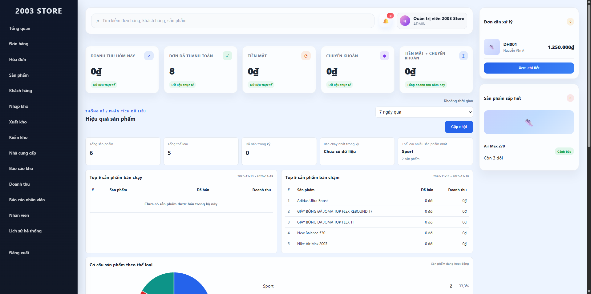

# Hệ thống quản lý cửa hàng giày dép 2003 Store



> Ứng dụng web nội bộ hỗ trợ bán hàng, quản lý kho, nhân viên và báo cáo kinh doanh cho cửa hàng giày 2003 Store.

## 1. Tên dự án
Tên website: 2003 Store  
Mô tả: Hệ thống quản lý bán hàng và kho dành cho cửa hàng giày dép, được xây dựng bằng Java Servlet/JSP theo mô hình phân quyền người dùng.

## 2. Giới thiệu

### Mục đích

- Quản lý sản phẩm, đơn hàng, khách hàng và nhà cung cấp.
- Theo dõi nhập kho, xuất kho và kiểm kê tồn kho.
- Hỗ trợ nhân viên tạo đơn hàng và xác nhận thanh toán.
- Cung cấp báo cáo doanh thu, tồn kho và hoạt động nhân viên.
- Phân quyền chức năng phù hợp cho từng vai trò trong cửa hàng.

### Đối tượng sử dụng

- **Quản trị viên (Admin):** quản lý toàn bộ hệ thống, nhân sự và cấu hình.
- **Quản lý (Manager):** vận hành kho, đơn hàng, sản phẩm và theo dõi báo cáo.
- **Nhân viên (Staff/Employee):** bán hàng, quản lý khách hàng và xử lý đơn.

## 3. Công nghệ

| Thành phần | Công nghệ |
|---|---|
| Ngôn ngữ | Java 17 |
| Backend | Jakarta Servlet 5.0, JDBC |
| Frontend | JSP, JSTL, HTML, CSS, JavaScript |
| Cơ sở dữ liệu | MySQL 8 |
| Build tool | Apache Maven |
| Máy chủ ứng dụng | Apache Tomcat 10.1+ |
| Thư viện thanh toán | VietQR |
| Kiểm thử | JUnit 5 |

## 4. Chức năng

- Đăng nhập và phân quyền theo vai trò: `ADMIN`, `MANAGER`, `EMPLOYEE`.
- Dashboard tổng quan với dữ liệu doanh thu, đơn hàng và hoạt động cửa hàng.
- Quản lý sản phẩm: tạo mới, sửa, tìm kiếm, lọc và khóa sản phẩm.
- Quản lý khách hàng, nhà cung cấp và nhân viên.
- Tạo đơn hàng, xem chi tiết, cập nhật trạng thái và thanh toán.
- Quản lý nhập kho, xuất kho, kiểm kê và chi tiết kho.
- Báo cáo doanh thu theo ngày, tháng và năm.
- Báo cáo tồn kho và hiệu suất nhân viên.
- Lưu nhật ký đăng nhập.
- Tạo mã QR VietQR và cấu hình thông tin tài khoản nhận tiền.
- Kiểm tra quyền truy cập ở cả giao diện và Servlet phía server.

## 5. Giao diện

### Giao diện tổng quan


Các trang chính của hệ thống bao gồm:

- Trang đăng nhập và chuyển hướng theo vai trò.
- Dashboard quản trị với biểu đồ doanh thu và đơn hàng gần đây.
- Trang quản lý sản phẩm, khách hàng, đơn hàng và nhà cung cấp.
- Trang nhập kho, xuất kho, kiểm kê và báo cáo thống kê.

## 6. Cấu trúc project

```text
2003 Store/
├── src/
│   ├── main/
│   │   ├── java/com/_2003store/
│   │   │   ├── config/       # Cấu hình database và UTF-8
│   │   │   ├── dao/          # Truy cập và thao tác dữ liệu JDBC
│   │   │   ├── model/        # Các đối tượng dữ liệu
│   │   │   ├── service/      # Logic nghiệp vụ, xác thực và báo cáo
│   │   │   └── servlet/      # Controller xử lý request/response
│   │   └── webapp/
│   │       ├── css/          # Giao diện CSS
│   │       ├── WEB-INF/      # Cấu hình web và sidebar chung
│   │       └── *.jsp         # Trang giao diện theo chức năng
│   └── test/java/            # Unit test JUnit 5
├── Dump20261006.sql          # File dump MySQL
├── pom.xml                   # Cấu hình Maven và dependencies
└── README.md
```

## 7. Yêu cầu môi trường

- JDK 17 trở lên.
- Apache Maven 3.8 trở lên.
- Apache Tomcat 10.1+ hỗ trợ Jakarta Servlet 5.
- MySQL 8.0 trở lên.
- IDE khuyến nghị: IntelliJ IDEA, Eclipse hoặc VS Code.
- Trình duyệt hiện đại: Chrome, Edge hoặc Firefox.

Kiểm tra công cụ đã cài:

```bash
java -version
mvn -v
mysql --version
```

## 8. Cài đặt

### 1. Clone repository

```bash
git clone https://github.com/HenryLam47510/code-java.git
cd code-java
```

### 2. Tạo và import database

Thực hiện trong MySQL:

```sql
CREATE DATABASE 2003_store
  CHARACTER SET utf8mb4
  COLLATE utf8mb4_unicode_ci;
```

Sau đó import file dump:

```bash
mysql -u root -p 2003_store < Dump20261006.sql
```

Trên MySQL Workbench, có thể mở `Dump20261006.sql`, chọn database `2003_store` và chạy toàn bộ script.

### 3. Cấu hình kết nối database

Mặc định, `DatabaseConfig` sử dụng:

- URL: `jdbc:mysql://localhost:3306/2003_store`
- User: `root`
- Password: `dung123`

Khuyến nghị thay thông tin bằng biến môi trường thay vì sửa trực tiếp mã nguồn:

**Windows (PowerShell):**

```powershell
$env:DB_URL="jdbc:mysql://localhost:3306/2003_store?useSSL=false&allowPublicKeyRetrieval=true&serverTimezone=UTC"
$env:DB_USER="root"
$env:DB_PASSWORD="<mat-khau-mysql-cua-ban>"
```

**Linux/macOS:**

```bash
export DB_URL="jdbc:mysql://localhost:3306/2003_store?useSSL=false&allowPublicKeyRetrieval=true&serverTimezone=UTC"
export DB_USER="root"
export DB_PASSWORD="<mat-khau-mysql-cua-ban>"
```

## 9. Chạy project

### Build bằng Maven

```bash
mvn clean package
```

File deploy được tạo tại:

```text
target/2003-store.war
```

### Deploy lên Tomcat

1. Khởi động MySQL.
2. Sao chép `target/2003-store.war` vào thư mục `webapps` của Tomcat.
3. Khởi động Tomcat bằng `startup.bat` (Windows) hoặc `startup.sh` (Linux/macOS).
4. Truy cập:

```text
http://localhost:8080/2003-store/
```

Nếu cấu hình server khác cổng mặc định, thay `8080` bằng cổng Tomcat đang sử dụng.

### Chạy test

```bash
mvn test
```

## 10. Tài khoản demo

Các tài khoản sau được lưu trong file SQL dump:

| Vai trò | Tên đăng nhập | Mật khẩu | Quyền chính |
|---|---|---|---|
| Admin | `admin` | `123456` | Quản trị hệ thống, nhân viên, báo cáo và toàn bộ dữ liệu |
| Quản lý | `manager` | `123456` | Quản lý kho, đơn hàng, sản phẩm, nhà cung cấp và báo cáo |
| Nhân viên | `staff` | `123456` | Tạo đơn, xử lý bán hàng và quản lý khách hàng |

Hệ thống cũng có tài khoản demo dự phòng trong `AuthService`:

- `employee / 123456`: tài khoản nhân viên.
- `cashier / 123456`: tài khoản thu ngân dành cho luồng thanh toán.

## 11. Database

File `Dump20261006.sql` chứa cấu trúc và dữ liệu mẫu cho database `2003_store`.

Các bảng chính:

- `employees`: tài khoản và vai trò nhân viên.
- `employee_permissions`: quyền chi tiết theo từng tài khoản.
- `products`: danh mục sản phẩm giày dép.
- `customers`: thông tin khách hàng.
- `orders` và `order_items`: đơn hàng và chi tiết đơn.
- `suppliers`: nhà cung cấp.
- `stock_receipts` và `stock_issues`: nhập kho và xuất kho.
- `inventory_counts`: dữ liệu kiểm kê.
- `payment_configs`: cấu hình VietQR.
- `login_history`: lịch sử đăng nhập.

Cách import bằng dòng lệnh:

```bash
mysql -u root -p -e "CREATE DATABASE IF NOT EXISTS 2003_store CHARACTER SET utf8mb4 COLLATE utf8mb4_unicode_ci;"
mysql -u root -p 2003_store < Dump20261006.sql
```

## 12. Tác giả

- **Người thực hiện:** Nguyễn Hoàng Lâm
- **GitHub:** [HenryLam47510](https://github.com/HenryLam47510)
- **Email:** nguyenhoanglam27032004@gmail.com
- **Repository:** [HenryLam47510/code-java](https://github.com/HenryLam47510/code-java)

## Giấy phép

Dự án được phát triển cho mục đích học tập và phục vụ đồ án môn học. Khi sử dụng hoặc phân phối lại, vui lòng ghi nguồn repository gốc.
